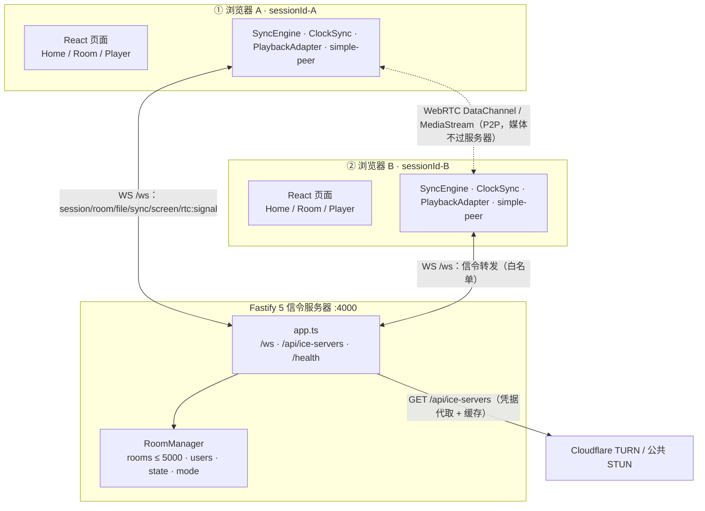
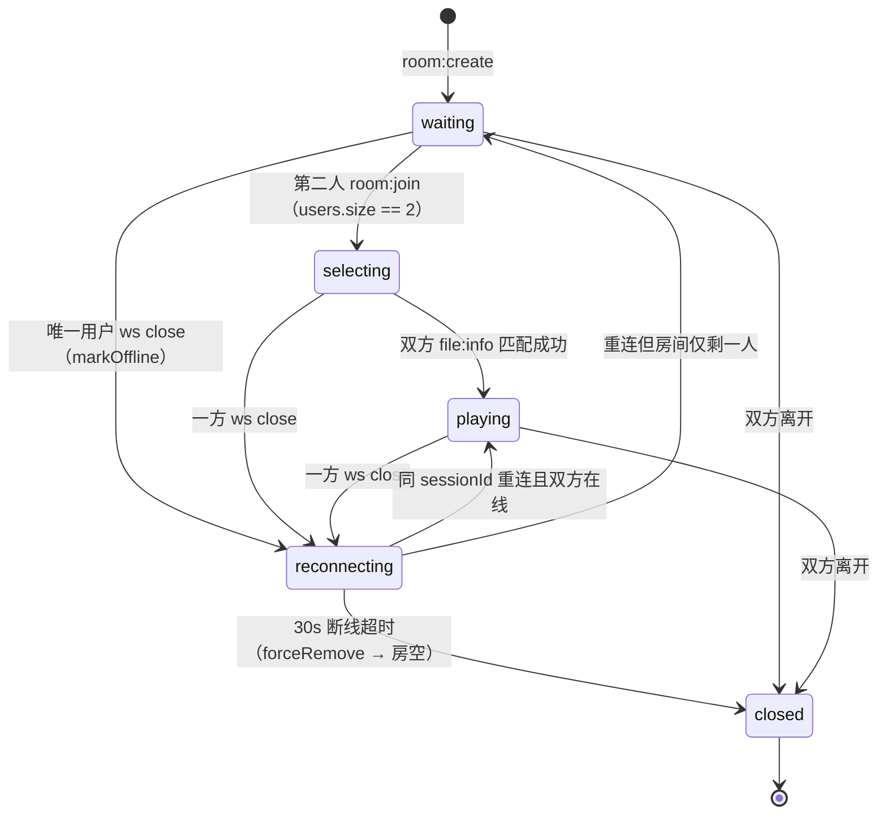
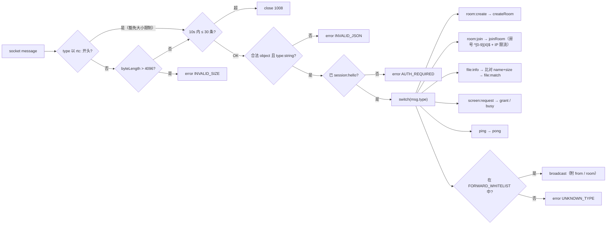
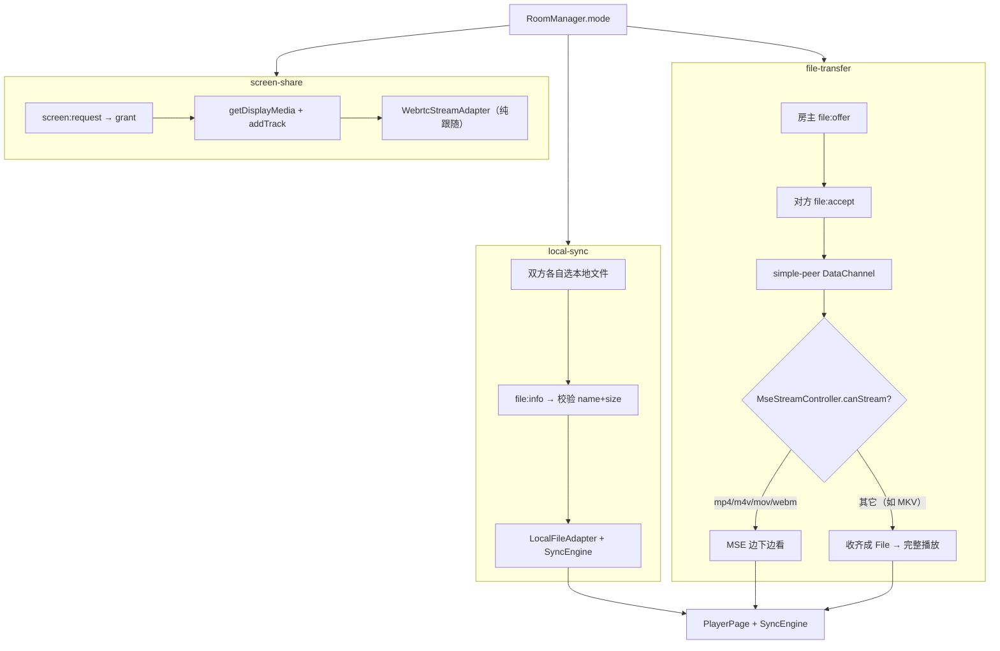

<div align="center">

> [English](./README_en.md) | **简体中文**


# SameMoon · 异地同步观影

**隔着一块屏幕，也像坐在同一张沙发上 —— 同一部片、同一条进度条，播放 / 暂停 / 拖动实时同步。**


</div>

---

## 它解决什么问题

异地想和 TA 一起看一部电影，通常只剩三条路：屏幕共享（画质被压、上传带宽吃满）、浏览器同步插件（只对特定视频站有效）、或者「3、2、1，一起按播放」（人肉同步，暂停一下就散了）。

**SameMoon 把这件麻烦事变成一个 4 位房间号。** 创建房间 → 把链接丢给对方 → 各就各位，进度条就锁在了一起。

- **文件不上传**：本地模式双方各持一份片源，`URL.createObjectURL(file)` 本机播放，片源永不经过服务器。
- **零注册零安装**：无账号、无数据库，打开网页即用。
- **服务器只做信令**：房间管理与信令转发，媒体数据永远走点对点通道。

> 隐私承诺：本地文件模式不产生任何文件上传；P2P 模式下文件/媒体走浏览器之间的 WebRTC 通道，服务器只转发用于牵线的信令。

---

## ✨ 功能

- 🎬 **三种观影模式**
  - `local-sync`：双方各自持有同一部影片，校验「文件名 + 大小」一致后同步播放。
  - `file-transfer`：房主把片源 P2P 直传给对方，对方无需本地已下载。
  - `screen-share`：一方实时分享屏幕，另一方纯跟随观看。
- ⏱️ **亚秒级同步引擎**：NTP 式时钟校准 + 一整套防抖机制（回声抑制、`seq` 冲突解决、三档漂移校正、缓冲协商）。
- 🔗 **P2P 优先**：基于 `simple-peer` 的 DataChannel 直传，Cloudflare TURN 兜底 NAT 穿透，信令统一为一条 `rtc:signal`。
- 📥 **边下边看**：MP4（faststart）/ MOV 用 `mp4box` 实时 remux 成 fMP4 喂给 `MediaSource`，WebM 直连；MKV 等不支持流式的格式自动降级为「完整传输」。
- 🖥️ **屏幕分享可调**：四档画质（流畅 / 标准 / 高清 / 极致）+ 帧率 / 音频码率 + 卡顿优先级（保音频 / 保画面 / 保帧率）+ 抖动缓冲（最低延迟 / ≈1s / ≈2s）。
- ♻️ **会话恢复**：`sessionStorage` 稳定 `sessionId`，刷新或断线后 30s 内以同一身份重连并恢复房间。
- 🛡️ **服务端加固**：消息限大小 / 限频率、转发白名单、房号正则、每 IP join 限流、房间总数上限。
- 🧭 **诊断面板**：WS 消息日志、ICE 候选路由、RTC 传输统计，一键导出完整诊断快照。

---

## 🚀 快速开始

### 方式一：面向 AI Agent（一键安装，推荐）

把下面这段提示词直接发给你的本地 AI Agent（Claude Code / Codex / OpenCode …）：

````markdown
请帮我本地运行 SameMoon（GitHub: https://github.com/RayMorTwinkle/SameMoon）。
背景：SameMoon 是一个异地同步观影 Web 应用，前端 React 19 + Vite，后端 Fastify 5 + WebSocket。

步骤：
1. 克隆：git clone https://github.com/RayMorTwinkle/SameMoon.git && cd SameMoon
2. 安装依赖（前端 + 后端）：npm run install:all
3. 一键启动前后端：npm run dev
   - 前端 http://localhost:3000（Vite，/ws 与 /api 已代理到后端）
   - 后端 http://localhost:4000（Fastify 信令服务器）
4. 打开两个浏览器窗口（或一个隐私窗口）分别访问 http://localhost:3000，
   一个「创建房间」，另一个用 4 位房间号「加入」，验证房间联通。
5. 可选：运行测试 `cd server && npm test` 与 `cd client && npm test`。
6. 向用户确认启动成功，并简述三种观影模式的区别。
````

### 方式二：面向人类用户

```bash
git clone https://github.com/RayMorTwinkle/SameMoon.git
cd SameMoon
npm run install:all     # 依次安装 client/ 与 server/ 依赖
npm run dev             # concurrently 同时启动前后端
```

> **环境要求**：Node.js 18+（开发使用 Node 22 部署）、npm。前端 dev 端口 3000，后端端口 4000。
> `npm run dev` 会把 `/ws`（WebSocket）与 `/api` 代理到后端，无需额外配置。

---

## 🖥️ 使用

### 典型工作流（本地同步模式）

```text
① 打开 http://localhost:3000
② A 选择「本地同步」→ 点击「创建房间」→ 得到 4 位房间号与链接
③ A 把链接发给 B → B 打开即自动加入
④ 双方各自选择同一部影片（拖拽或点击，支持 .mp4/.webm/.m4v/.mov/.mkv）
   → 服务端比较「文件名 + 字节大小」，一致则匹配成功
⑤ 双方各自点击「准备好了」（用于解锁浏览器自动播放权限）
⑥ 进入同步播放：任一方播放 / 暂停 / 拖动 / 变速，另一方自动跟随
```

### 三种模式一览

| 模式 | 片源来源 | 谁操作 | 传输通道 |
|------|----------|--------|----------|
| `local-sync` | 双方各自的本地文件 | 双方各自选文件 | 无（仅同步信令走 WS） |
| `file-transfer` | 房主的本地文件 | 房主发起 → 对方接收 | WebRTC DataChannel（P2P） |
| `screen-share` | 分享方的屏幕 | 任一方发起（同时仅一人） | WebRTC MediaStream（P2P） |

### 环境变量（`server/.env`）

```bash
# Cloudflare TURN（可选；不配置则仅使用公共 STUN）
TURN_KEY_ID=your_cloudflare_turn_key_id
TURN_API_TOKEN=your_cloudflare_turn_api_token
```

### 构建与测试

| 命令 | 作用 |
|------|------|
| `npm run dev` | 同时启动前端（3000）与后端（4000） |
| `npm run dev:client` / `npm run dev:server` | 单独启动前端 / 后端 |
| `cd client && npm run build` | 前端类型检查 + 生产构建（输出 `client/dist`） |
| `cd client && npm test` | 前端 vitest（`SyncEngine` 纯逻辑单测） |
| `cd server && npm test` | 后端 vitest（RoomManager / 集成 / 同步转发） |

### 生产部署

```bash
# 方式一：docker compose（nginx 静态托管 + Node 信令服务）
docker compose up -d --build

# 方式二：使用仓库内的一键脚本（会先 git push 再 SSH 到服务器重建）
./deploy.sh
# 或按 docs/更新服务器SameMoon.sh 的「本地构建 + rsync 上传」流程
```

> 生产通过 `nginx.conf` 将 `80` 重定向到 `443`，静态文件走 `client/dist`，
> `/ws` 升级为 WebSocket，`/api` 反代到容器内的 `sm-server:4000`。

---

## 🏗️ 架构

### 系统总览

两台浏览器之间：信令走 WebSocket，媒体走 WebRTC P2P；服务器只负责房间管理与牵线。



### 同步观影时序（SyncEngine）

所有 `sync:*` 消息携带完整 `PlaybackState`（全量幂等），程序化施加远端状态时用 `applyingRemote` 抑制回声。

```mermaid
sequenceDiagram
  autonumber
  participant UA as 用户 A（房主）
  participant EA as A: SyncEngine
  participant S as Fastify（/ws 转发）
  participant EB as B: SyncEngine
  participant UB as 用户 B

  Note over EA,EB: 进房后连续采样 5 次 → 取 RTT 最小 3 个的 offset 中位数

  UA->>EA: 点击「暂停」
  EA->>EA: captureState()（seq+1，sentAt = rawNow）
  EA->>S: sync:pause {paused, time, rate, seq, senderId, sentAt}
  S->>EB: 白名单转发 sync:pause
  EB->>EB: shouldAccept()：seq 大者胜，seq 同则 senderId 大者胜
  EB->>EB: applyRemote()：补偿传输延迟 + 回声抑制窗口
  EB->>UB: 视频暂停（本地事件被抑制，不再广播）

  loop 每 5s
    EA->>S: sync:heartbeat {clientTime, time, paused, rate}
    S->>EB: 转发
    EB->>EA: 回包 {echoOf=t0, t1, clientTime=t2}
    EA->>EA: ClockSync.addSample(t0,t1,t2,t3) → offset / RTT
    EA->>EA: 仅 follower（userId 较小方）做漂移校正
  end

  Note over EA,EB: 漂移 &lt;0.3s 忽略 ｜ 0.3~2s 变速 ±5% 追赶 ｜ &gt;2s 直接 seek

  UB-->>EB: 本地 waiting（进入缓冲）
  EB->>S: sync:buffering
  S->>EA: 转发 → A 暂停等待
  UB-->>EB: canplay
  EB->>S: sync:ready {time}
  S->>EA: 转发 → 对齐目标时间后恢复播放
```

### P2P 信令与传输流程（simple-peer）

信令统一为一条 `rtc:signal`（服务器纯转发），`rtc:*` 消息豁免 4KB 大小限制；trickle ICE 的候选先入 `pendingSignals` 缓冲，peer 建好后排空。

```mermaid
sequenceDiagram
  autonumber
  participant A as 浏览器 A（发起方）
  participant S as Fastify（rtc:signal 转发）
  participant T as Cloudflare TURN
  participant B as 浏览器 B（接收方）

  A->>T: GET /api/ice-servers（服务器代取凭据，TTL 24h，缓存提前 1h 刷新）
  Note over A,B: simple-peer：new Peer({ initiator: true / false, iceServers })
  A->>S: rtc:signal { offer }
  S->>B: 转发 rtc:signal
  B->>B: new Peer(initiator:false).signal(offer)
  B->>S: rtc:signal { answer }
  S->>A: 转发 rtc:signal
  A->>S: rtc:signal { candidate }
  B->>S: rtc:signal { candidate }
  Note over A,B: 未建 peer 时的 candidate 先缓冲，peer 就绪后 flushPending() 排空
  A-->>B: WebRTC DataChannel open（文件传输） / MediaStream（屏幕分享）
  Note over A,B: 文件传输 64KB 分块，bufferedAmount &gt;1MB 暂停 / &lt;256KB 恢复
```

### 房间状态机（RoomManager）



> 重连时服务端会先清空该用户的 `fileInfo` 并把 `playing` 退回 `selecting`，向对方广播 `file:reset`；
> 客户端据此提示「已恢复房间，请重新选择文件」。

### WebSocket 消息路由与安全闸门



### 三种模式的数据流



---

## 📂 目录结构

```text
SameMoon/
├── client/                          # React 19 + Vite 8 前端
│   ├── src/
│   │   ├── App.tsx                  # 路由 / · /room/:code · /room/:code/play + 全局面板
│   │   ├── hooks/useWebSocket.tsx   # 全局单连接 WS Context（sessionId / 重连 / 心跳）
│   │   ├── components/
│   │   │   ├── Room/HomePage.tsx    # 创建 / 加入房间 + 模式选择
│   │   │   ├── Room/RoomPage.tsx    # 等待室：三模式分支 UI
│   │   │   ├── Room/FileTransferPanel.tsx
│   │   │   ├── Player/PlayerPage.tsx # 播放 +「准备好了」授权 + 同步控制
│   │   │   └── common/              # DebugPanel / DebugExport / ErrorBoundary / ConnectionStats
│   │   ├── services/
│   │   │   ├── sync/SyncEngine.ts   # 同步引擎（与传输层解耦）
│   │   │   ├── sync/ClockSync.ts    # NTP 式时钟校准
│   │   │   ├── playback/            # PlaybackAdapter · LocalFileAdapter · WebrtcStreamAdapter · MseStreamController
│   │   │   ├── webrtc/              # simple-peer：ScreenShare · FileTransferService · PCStatsCollector · stores
│   │   │   └── debugStore.ts        # WS 日志 / RTC 统计 / 诊断导出
│   │   └── utils/                   # fileValidator · formatFileSize
│   └── vite.config.ts               # 端口 3000 + /ws · /api 代理 + node polyfills
├── server/                          # Fastify 5 信令服务器
│   ├── src/app.ts                   # /ws + /api/ice-servers + /health + 安全加固
│   ├── src/room/RoomManager.ts      # 房间 / 成员 / 状态机 / 断线倒计时
│   ├── src/ws/protocol.ts           # WS 消息类型定义
│   └── test/                        # vitest：RoomManager · integration · sync
├── docs/                            # NEO_PLAN · TECH-SPEC · stage2 PLAN/PLAN2 · 部署脚本
├── docker-compose.yml               # nginx 静态托管 + Node 服务
├── nginx.conf                       # HTTPS + /ws 升级 + /api 反代
├── deploy.sh                        # 一键部署脚本
└── wireframe.html                   # 初始界面线框
```

---

## 🔧 技术细节

**房间与重连**

| 项 | 值 / 位置 |
|---|---|
| 房间号 | `String(Math.floor(1000 + Math.random() * 9000))`，服务端正则 `/^\d{4}$/` |
| 房间总数上限 | `RoomManager.MAX_ROOMS = 5000`，超出 `SERVER_FULL` |
| 房间状态 | `waiting` / `selecting` / `playing` / `reconnecting` / `closed` |
| 断线重连窗口 | `disconnectTimeoutMs` 默认 `30_000`（构造可注入，便于测试） |
| 用户身份 | `sessionStorage['sm-session']`（`crypto.randomUUID`，非安全上下文降级为手写 UUID） |

**同步引擎（`client/src/services/sync`）**

| 项 | 值 |
|---|---|
| 时钟校准 | 滑动窗口最多 10 样本，取 RTT 最小 3 个的 offset 中位数；`isReady` = 样本 ≥ 3 |
| 漂移阈值 | `driftIgnoreThreshold = 0.3s`；`driftRateThreshold = 2.0s` |
| 变速追赶 | 落后 `playbackRate = 1.05`，领先 `0.95`；`SEEK_MIN_DELTA = 0.5s` 内不 seek |
| 回声抑制 | `applyingRemote` + `echoWindow` 默认 150ms；seek 后抑制窗口 `SEEK_ECHO_MS = 1500ms` |
| 冲突解决 | `seq` 大者胜；`seq` 相同则 `senderId` 字典序大者胜 |
| leader/follower | `userId` 较小方为 leader（基准），仅 follower 做漂移校正，避免互相拉扯 |
| 缓冲超时 | `BUFFERING_TIMEOUT_MS = 30_000`，超时通知 UI 可「独立观看」 |

**P2P 与文件传输（`client/src/services/webrtc`）**

| 项 | 值 |
|---|---|
| 分块大小 | `CHUNK_SIZE = 64 * 1024`（64KB，所有浏览器安全支持） |
| 流控水位 | `HIGH_WATER = 1MB`（暂停发送）/ `LOW_WATER = 256KB`（恢复发送） |
| DataChannel | `channelConfig: { ordered: true }`，标签由 simple-peer 管理 |
| 信令 | 统一 `rtc:signal`；`rtc:*` 豁免 4KB 限制；未建 peer 的候选入 `pendingSignals` |
| MSE 流式 | `MseStreamController.canStream()` 匹配 `\.(mp4|m4v|mov|webm)$` 或 mime 含 mp4/webm；MP4 走 `mp4box` remux，`setSegmentOptions(id, sb, { nbSamples: 200 })` |
| 屏幕分享预设 | smooth 2Mbps/720p/30 · balanced 5Mbps/1080p/30 · high 10Mbps/1080p/60 · ultra 20Mbps/2160p/60 |
| 音频 | 默认 128kbps；观看方 SDP 注入 opus `stereo=1;sprop-stereo=1;maxaveragebitrate=256000` |

**服务端加固与 ICE（`server/src`）**

| 项 | 值 |
|---|---|
| 单条消息大小 | `MAX_MSG_SIZE = 4096`（4KB） |
| 消息频率 | `RATE_MAX_MSGS = 30` / `RATE_WINDOW_MS = 10_000`（滑动窗口），超出 `close(1008)` |
| 未 hello 超时 | `HELLO_TIMEOUT_MS = 10_000`，超时 `close(1002)` |
| 聊天长度 | `CHAT_MAX_LENGTH = 500`，超出截断 |
| join 限流 | `JOIN_MAX_PER_MINUTE = 20`（每 IP，防 4 位房号枚举） |
| 转发白名单 | `FORWARD_WHITELIST`：`sync:*` / `chat:message` / `rtc:signal` / `file:*` / `screen:*` / `player:ready` 等；其余 `UNKNOWN_TYPE` |
| ICE 凭据 | `GET /api/ice-servers` 缓存 TTL = `86_400 - 3_600` 秒；无凭据回退 `stun.cloudflare.com:3478` + `stun.l.google.com:19302` |

**端口与路由**

| 项 | 值 |
|---|---|
| 前端 dev / 预览 | `3000`（Vite，`/ws` 与 `/api` 代理到 4000） |
| 后端 | `4000`（`PORT` 可覆盖） |
| HTTP 端点 | `/health`（返回 `{ status, rooms }`）、`/api/ice-servers` |
| WebSocket | `/ws`（生产经 nginx `Upgrade` 升级） |
| 前端页面 | `/`、`/room/:code`、`/room/:code/play` |

---

## ❓ 常见问题

**Q：我的电影文件会被上传到服务器吗？**
A：不会。`local-sync` 模式文件仅在你本机通过 `URL.createObjectURL` 播放；`file-transfer` 走浏览器之间的 WebRTC DataChannel。服务器只转发信令，从不接触媒体数据。

**Q：必须配置 TURN 吗？**
A：不是必须。不配置时只使用公共 STUN，局域网或普通 NAT 下仍可直连；在对称型 NAT 等打洞失败的场景才需要 TURN 兜底（`server/.env` 中填 `TURN_KEY_ID` / `TURN_API_TOKEN`）。

**Q：房间最多几个人？**
A：当前为 2 人（`room.users.size >= 2` 即拒绝加入），面向「一对一看片」场景设计。

**Q：为什么有些 MKV 不能「边下边看」？**
A：`MediaSource` 不支持 MKV 容器，`MseStreamController.canStream()` 会返回 false，UI 自动切换为「完整传输」——传完再一起播。

**Q：手机能发起屏幕分享吗？**
A：不能。移动端浏览器（Android Chrome/Edge、iOS Safari）尚未实现 `getDisplayMedia`，只能作为观看方；请用电脑发起分享。

**Q：刷新页面后为什么要重新选文件？**
A：`objectURL` 在刷新后失效。服务端会通过 `session:restored` 恢复房间与上次的文件名/大小提示，但需要你重新选择同一文件（比对 name+size 后恢复进度）。

**Q：支持在线视频链接或 YouTube 吗？**
A：暂不支持。`PlaybackAdapter` 已预留 `direct-url` / `youtube` 源类型，属规划中的后续阶段。

---

## ⚠️ 注意事项

- **安全上下文**：`getDisplayMedia` / `getUserMedia` / 剪贴板等 API 需要 HTTPS（`localhost` 除外），生产必须启用 HTTPS/WSS。
- **4 位房间号可枚举**：已通过「每 IP 每分钟 20 次 join」限流缓解，但不适合作为强安全边界。
- **许可证**：仓库未附带 LICENSE 文件，默认保留所有权利；且 UI 组件库 `animal-island-ui` 采用 **CC BY-NC 4.0（非商用）**，商业化前需替换。
- **Dockerfile 缺失提示**：根目录 `docker-compose.yml` 引用了 `server/Dockerfile`，但当前仓库未包含该构建文件（部署产物位于服务器目录）。本地开发直接用 `npm run dev` 即可。
- **部署脚本含写操作**：`deploy.sh` 内部会执行 `git push` 并 SSH 到服务器重建容器，请勿在未确认时运行。
- **无 P2P 时的降级**：设计目标是 P2P 失败时保持 WS 可用；当前实现中文件传输/屏幕分享依赖 P2P，连接建立失败会提示重试。

---

## 📄 License

本仓库当前**未附带开源许可证文件**，默认保留所有权利（All rights reserved）。

若需对外分发或允许他人使用，请先补充一个许可证（如 MIT）。
注意：依赖的 `animal-island-ui` 采用 **CC BY-NC 4.0（非商用）**，本项目在商业化前需评估替换。

---

## 🙏 致谢 / Credits

- 本项目仓库：[RayMorTwinkle/SameMoon](https://github.com/RayMorTwinkle/SameMoon)
- UI 组件库 [animal-island-ui](https://www.npmjs.com/package/animal-island-ui)（动森风格，非商用许可）+ [lucide-react](https://lucide.dev/) 图标
- 播放器 [ArtPlayer](https://artplayer.org/)；容器解析 [mp4box.js](https://github.com/gpac/mp4box.js)
- P2P 封装 [simple-peer](https://github.com/feross/simple-peer)
- 后端 [Fastify](https://fastify.dev/) + [@fastify/websocket](https://github.com/fastify/fastify-websocket) + [@fastify/cors](https://github.com/fastify/fastify-cors)
- NAT 穿透凭据服务 [Cloudflare Realtime TURN](https://developers.cloudflare.com/realtime/turn/)
- 本 README（中英双语）与架构图为本项目重制。

---

<div align="center">
<sub>SameMoon · 月亮是同一个，我们一起看。</sub>
</div>
