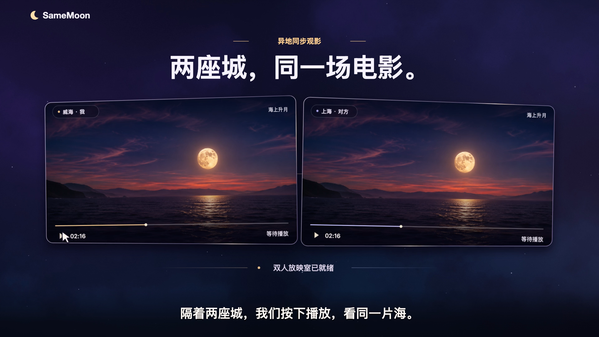
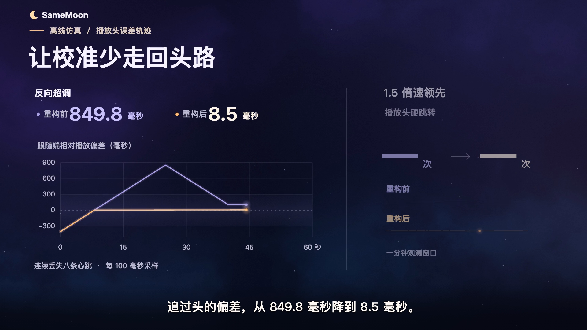
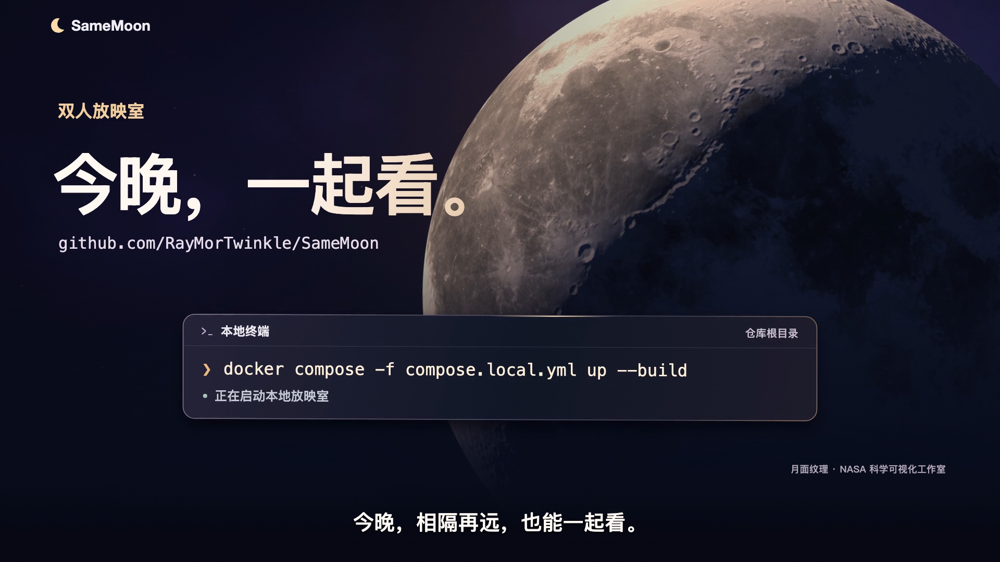
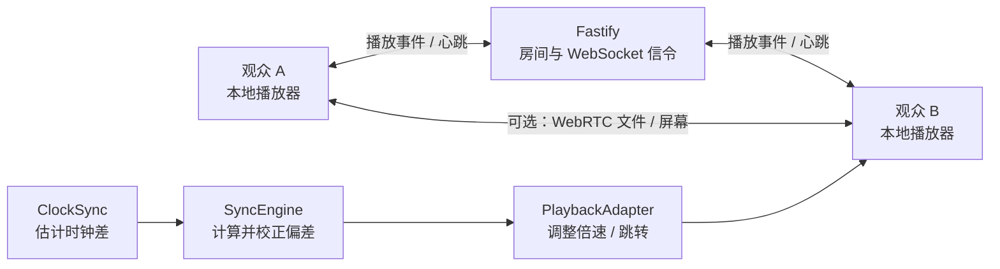

<p align="right"><strong>简体中文</strong> · <a href="README_en.md">English</a></p>

<div align="center">

# 🌙 SameMoon

### 相隔再远，也能一起看到同一个画面。

**一个双人浏览器放映室，把「等等，你看到哪了？」变成「我们继续吧」。**

[](client/package.json)
[](client/package.json)
[](server/package.json)
[](client/src/services/webrtc/)
<br>
[](#许可说明)
[](https://raymortwinkle.github.io/SameMoon/)
[](https://raymortwinkle.github.io/SameMoon/media/promo.mp4)
[](https://github.com/RayMorTwinkle/SameMoon)

**[✨ 在线交互体验站](https://raymortwinkle.github.io/SameMoon/) · [🎬 观看中文宣传片](https://raymortwinkle.github.io/SameMoon/media/promo.mp4) · [🚀 3 分钟上手](#快速上手) · [📊 实测对比](#实测对比) · [🏗️ 核心架构](#核心架构)**

</div>

<div align="center">
  <a href="https://raymortwinkle.github.io/SameMoon/media/promo.mp4"></a>
  <p><strong>🎬 点开封面，看看 SameMoon 的故事</strong><br><a href="https://raymortwinkle.github.io/SameMoon/media/promo.mp4">直接播放宣传片</a> · <a href="https://raymortwinkle.github.io/SameMoon/">打开交互展示站</a> · <a href="https://moon.raymor.top/">进入观影室</a></p>
  <video src="https://raymortwinkle.github.io/SameMoon/media/promo.mp4" controls poster="docs/media/poster.jpg" width="100%">你的浏览器不支持内嵌播放，请使用上方视频链接。</video>
  <p><sub>GitHub 的 README 可能不渲染 video 控件；点击封面或上方链接即可观看。</sub></p>
</div>

<table>
  <tr>
    <td align="center" width="50%"><br><strong>📈 让校准少走回头路</strong><br><sub>离线仿真中的播放误差轨迹</sub></td>
    <td align="center" width="50%"><br><strong>🌙 今晚，一起看</strong><br><sub>打开属于两个人的放映室</sub></td>
  </tr>
</table>

## 💡 为什么做它？

🍿 电影正看到精彩处，有人起身倒水，回来后又得对着进度条喊：「三、二、一，播放！」

SameMoon 让两个人在浏览器里共享一条播放节奏：暂停、拖动进度或调整倍速，都可以同步给对方。各有片源就各自播放本地文件；只有一份，也可以传文件或分享屏幕。

## ✨ 核心亮点

- 🎞️ **本地同步** · 双方各选一份影片，文件留在各自设备上，房间里传递同步消息。
- 📦 **一份片源也能看** · 通过 WebRTC 传给对方；兼容的 MP4/MOV、WebM 可尝试边收边播，其他容器先完整接收。
- 🖥️ **分享眼前的画面** · 授权共享窗口或桌面，对方跟随实时画面；可调整画质、帧率、音频和抖动缓冲。
- ⏱️ **照顾你选的倍速** · 同步引擎根据误差轻微调整速度，误差较大时再跳转；临时追赶结束后恢复所选倍速。
- 🚪 **轻装进房** · 无需账号，房间最多两人；创建后把四位房间号发给对方即可。
- 🔍 **连接情况看得见** · 诊断面板提供信令日志、连接路径与 RTC 统计，还能导出快照。

<details>
<summary>使用前的小提示</summary>

本地同步以文件名和字节数匹配片源，不校验内容哈希。刷新后本地文件句柄失效，重连回房间需要重新选择文件。文件能否播放、分享时可用的音源取决于浏览器和系统；远程屏幕分享需要 HTTPS 和浏览器授权。WebRTC 可能直连，也可能在配置 TURN 后经中继转发。

</details>

<a id="核心架构"></a>
## 🏗️ 工作原理

两边各有一个播放器。房间服务负责连接与信令；同步引擎估算时钟差和播放偏差，再让跟随端适时调整。需要传文件或分享屏幕时，媒体通过 WebRTC 送到另一位观众。



[时钟实现](client/src/services/sync/ClockSync.ts) · [同步引擎](client/src/services/sync/SyncEngine.ts) · [房间管理](server/src/room/RoomManager.ts)

<a id="实测对比"></a>
## 📊 实测改善 · Before vs After

同一套离线模拟分别运行重构前后的真实控制器。下面的时间是**模拟时间**，不是公网用户体验数据。

| 场景 / 指标 | 重构前 `backup1126` | 重构后 `refactor/1126` |
| --- | ---: | ---: |
| 固定同步场景中达到收敛条件 | 4 / 6 | **6 / 6** |
| 1.5×、跟随端超前 800 ms：收敛时间 | 未收敛 | **6.8 s** |
| 同一 1.5× 场景：一分钟内硬跳转 | 10 次 | **0 次** |
| 心跳中断场景：收敛时间 | 36.1 s | **2.1 s** |
| 心跳中断场景：反向过冲 | 849.750 ms | **8.527 ms** |
| 房间恢复状态检查符合预期 | 2 / 5 | **5 / 5** |

<details>
<summary>📐 测量口径、反例与边界</summary>

收敛指播放头误差进入 ±300 ms 后一直保持到 60 s 观察终点，且至少有 5 s 的后续观测；未收敛不赋予具体时间。过冲是越过零点后，沿初始偏差反方向的最大距离。心跳中断场景在播放后允许第一条心跳，再于 1–25 s 抑制发送；测量的是初始播放偏差的恢复，不是断线重连或新指令响应时间。房间恢复是另行执行的五项状态检查。

常速、跟随端落后 700 ms 的收敛时间前后均为 8.1 s。另一组强非对称网络压力场景中，收敛数为 **0 / 4 → 2 / 4**；长时间失联和接近阈值的两例仍未收敛。模拟使用预热后的时钟和简化播放器，未测量真实浏览器解码、后台节流、NAT 穿透或公网延迟，也不能推断用户满意度。[完整报告、方法与复现](docs/evals/refactor-1126-report.md) · [压力场景数据](docs/evals/artifacts/sensitivity-after.json)

</details>

<a id="快速上手"></a>
## 🚀 3 分钟本地跑起来

准备好 **Docker 和 Compose**，在终端运行：

```sh
git clone https://github.com/RayMorTwinkle/SameMoon.git
cd SameMoon
docker compose -f compose.local.yml up --build
```

首次启动需要下载镜像和依赖，耗时取决于网络。启动后打开 [localhost:3000](http://localhost:3000)：

1. 选择「本地同步」并创建房间，把四位房间号发给另一位观众。自己体验时，可以用普通窗口和隐私窗口。
2. 对方加入房间，两边选择**文件名和字节数相同**的影片。
3. 进入播放器，各自点击「准备好了」，然后试试播放、暂停和拖动进度条。

端口被占用时，可设置 `SAMEMOON_LOCAL_PORT`；停止服务运行 `docker compose -f compose.local.yml down`。

<details>
<summary>🛠️ 想参与开发？</summary>

需要 Node.js 24 和 npm。在仓库根目录运行 `npm run dev`，首次启动会安装锁文件中的依赖。前端默认端口为 3000，信令服务默认端口为 4000；切换启动方式前请先停止占用端口的实例。运行 `npm test` 可执行客户端和服务端测试。

</details>

## 📚 延伸阅读 & 许可

- ✨ [GitHub Pages 交互展示站](https://raymortwinkle.github.io/SameMoon/) · [同步实验室](https://raymortwinkle.github.io/SameMoon/#lab) · [在线观影室](https://moon.raymor.top/)
- 📊 [完整评测报告与复现方法](docs/evals/refactor-1126-report.md) · [设计记录](docs/stage1/TECH-SPEC.md)
- 👋 [Ray 的个人主页](https://raymor.top)

<a id="许可说明"></a>
**许可说明：**当前仓库尚未附上项目级 `LICENSE` 文件；锁定版本的 UI 依赖 `animal-island-ui` 1.4.0 声明为 `CC-BY-NC-4.0`。再分发或商用前请核对项目及依赖授权。[依赖锁文件](client/package-lock.json)

<div align="center">
  <br>
  <strong>🌙 今晚，找个人一起看吧。</strong><br>
  如果 SameMoon 让你想起了那个一起看片的人，欢迎点个 ⭐ Star。
</div>
