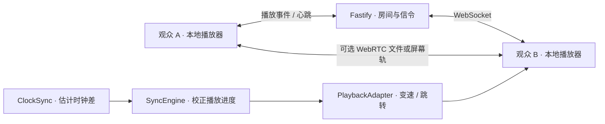

<p align="right"><strong>简体中文</strong> · <a href="README_en.md">English</a></p>

# SameMoon · 两个人，一起看片

一人暂停倒杯水，两边的电影一起等。SameMoon 是一个双人浏览器放映室。各自有片源时，两边都播放本机文件，只传同步消息。只有一份文件时，可以传给对方，也可以直接共享屏幕。

[打开观影室](https://moon.raymor.top/) · [观看产品短片](docs/media/promo.mp4) · [交互式同步实验室](https://raymortwinkle.github.io/SameMoon/#lab) · [工程评测报告](docs/evals/refactor-1126-report.md)

[](docs/media/promo.mp4)

## 三分钟上手

**自托管**需要 Docker 和 Compose。从仓库根目录启动，首次会下载镜像和依赖。端口已被占用时，可通过 `SAMEMOON_LOCAL_PORT` 指定宿主机端口。

```sh
git clone https://github.com/RayMorTwinkle/SameMoon.git
cd SameMoon
docker compose -f compose.local.yml up --build
```

**本地开发**需要 Node.js 24 和 npm。在同一仓库根目录运行：

```sh
npm run dev
```

首次启动自动安装锁文件中的依赖。开发模式的前端默认在 3000，信令服务在 4000。切换启动方式前请先停止占用端口的实例。

1. 打开 [localhost:3000](http://localhost:3000)，选「本地同步」并创建房间。把四位房间号发给另一位观众。单机体验可以用一个普通窗口和一个隐私窗口。
2. 在另一窗口加入房间。双方选中各自的同一部影片，文件名和字节数须相同。这是匹配条件，不校验内容哈希。
3. 双方进入播放器并点击「准备好了」。任一方暂停、拖动进度条或调整倍速，观察另一边的响应。

## 怎么选观影模式

| 场景 | 模式 | 片源与操作 |
| --- | --- | --- |
| 双方各有一份 | 本地同步 | 文件留在各自设备上，任一方都能控制播放。 |
| 只有房主有文件 | 文件传输 | 对方接受后通过 WebRTC DataChannel 接收。兼容的 MP4/MOV、WebM 可以尝试边收边播；其他容器先传完整文件，最终播放仍取决于浏览器解码支持。 |
| 想分享窗口或桌面 | 屏幕分享 | 分享者授权捕获，另一端跟随实时画面。画质、帧率、音频和抖动缓冲可以调整，实际可用音源取决于浏览器与系统。 |

房间无需账号，最多两人。刷新会使本地文件句柄失效，在重连宽限期内回到房间后，可重新选择片源。诊断面板可查看信令日志、连接路径与 RTC 统计，并导出快照。

## 一条时间轴，两份媒体



时钟采样让接收端能把发送时刻换算到自己的时钟。引擎按对端的播放倍速推算当前位置，只让跟随端执行漂移校正。小误差留在容忍区间，中等误差以用户所选倍速为基准短暂加速或减速，大误差才跳转。追赶有本地截止时间，即使下一条心跳丢失也能恢复原倍速。[时钟实现](client/src/services/sync/ClockSync.ts) · [同步引擎](client/src/services/sync/SyncEngine.ts) · [房间状态](server/src/room/RoomManager.ts)

WebSocket 服务处理房间和信令，本地模式不会向它上传影片。传文件和共享屏幕会把媒体送给另一位观众。WebRTC 可直连，配置 TURN 后也可能由中继转发。远程共享屏幕需要 HTTPS 和浏览器授权，localhost 可用于本机体验。

## 同步评测

同一套虚拟网络和播放器分别运行在 `backup1126` 和 `refactor/1126` 的真实控制器上。下表的秒数是模拟时间。收敛指第一次进入 ±300 ms，持续至 60 s 终点且至少保持 5 s。过冲指跨过零点后，沿初始偏差反方向的最大距离。

| 指标 | backup1126 | refactor/1126 |
| --- | ---: | ---: |
| 达到收敛条件的固定场景 | 4/6 | 6/6 |
| 1.5×、跟随端超前 800 ms · 收敛时间 | 未收敛 | 6.8 s |
| 1.5×、跟随端超前 800 ms · 过冲 | 4175.148 ms | 0 ms |
| 心跳中断 · 收敛时间 | 36.1 s | 2.1 s |
| 心跳中断 · 过冲 | 849.750 ms | 8.527 ms |
| 常速、跟随端落后 700 ms · 收敛时间 | 8.1 s | 8.1 s |
| 房间恢复场景 · 状态符合预期 | 2/5 | 5/5 |

六组轨迹覆盖不同倍速、失联、容忍区间和强制跳转。房间恢复单独用五组状态检查评估。另用强非对称网络复核四个场景，收敛数为 0/4 → 2/4，长时间失联和初始误差接近阈值的两例仍未收敛。[额外压力场景](docs/evals/artifacts/sensitivity-after.json)

以上数据来自离线测试，浏览器解码、设备负载和公网链路仍需实机测量。[基线轨迹](docs/evals/artifacts/sync-before.json) · [改后轨迹](docs/evals/artifacts/sync-after.json) · [报告与复现命令](docs/evals/refactor-1126-report.md)

## 开发与部署

| 命令或入口 | 用途 |
| --- | --- |
| `npm test` | 运行客户端同步测试，以及服务端构建、房间与信令测试。先用 `npm run dev` 完成依赖安装。 |
| `npm --prefix client run build` | 前端类型检查与构建，产物位于 `client/dist`。 |
| `npm --prefix server run build` | 编译 Fastify 信令服务。 |
| `docker compose -f compose.local.yml down` | 停止独立的本地 Compose 实例。 |
| [Pages 源文件](docs/index.html) | 从仓库的 `/docs` 发布；页面可独立打开，交互图表无需构建或第三方脚本。 |

已有生产部署在 `moon.raymor.top` 提供服务，入口使用 3000，沿用 `/ws`、`/api/ice-servers` 和 `/health`。本地 Compose 位于独立文件。可选 TURN 服务沿用 `TURN_KEY_ID` 和 `TURN_API_TOKEN`，通过服务运行环境提供。涉及宿主机同步和远程发布的脚本独立于本地启动流程。[历史架构与运维说明](https://github.com/RayMorTwinkle/SameMoon/blob/49f0fc7234558e71d67e5381c18b88c58e10ab93/README.md) · [设计记录](docs/stage1/TECH-SPEC.md)

## 路线图

- 在两个真实浏览器中记录媒体时钟，把解码、自动播放限制及后台标签节流纳入评测。
- 扩充网络模型，覆盖上下行不对称、长时间时钟漂移和重连后的首轮同步。
- 播放适配器已预留在线源类型；直链与第三方播放器仍属于后续方向。

## 许可与致谢

当前仓库公开可读，尚未附上项目级 `LICENSE` 文件。锁定版本的 UI 依赖 `animal-island-ui` 1.4.0 声明为 `CC-BY-NC-4.0`。请在再分发或商用前核对项目及依赖授权。[依赖锁文件](client/package-lock.json)

播放器使用 ArtPlayer，媒体解析使用 mp4box.js，WebRTC 连接使用 simple-peer，房间服务使用 Fastify。[客户端依赖](client/package.json) · [服务端依赖](server/package.json)
