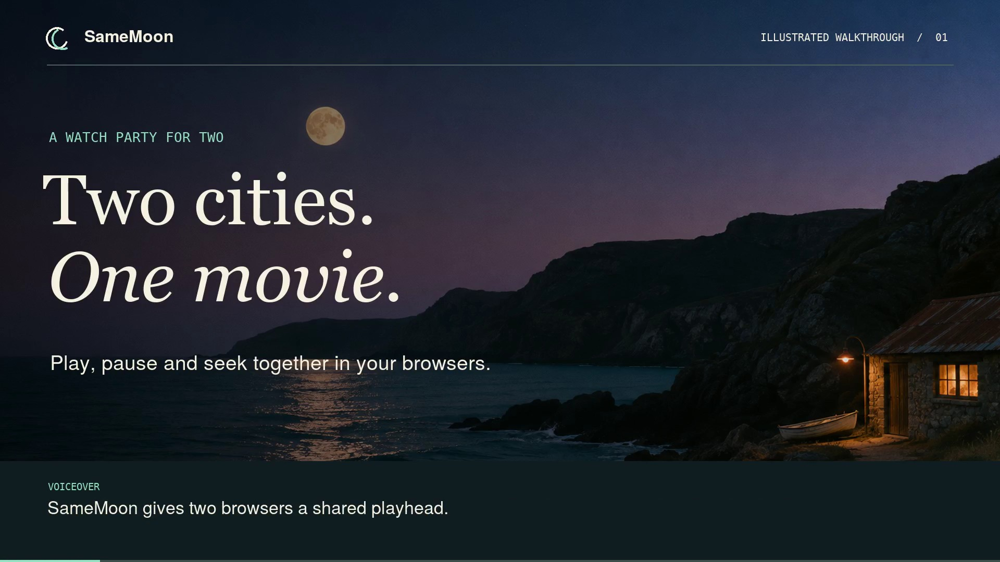
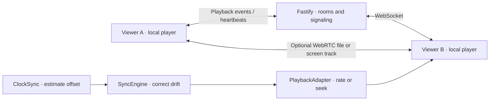

<p align="right"><a href="README.md">简体中文</a> · <strong>English</strong></p>

# SameMoon · A movie for two

When one person pauses to make tea, both screens wait. SameMoon is a two-person watch room in the browser. If you both have the film, each copy plays locally and the room carries playback events. With one copy, you can offer the file to your partner or share your screen.

[Open a watch room](https://moon.raymor.top/) · [Watch the walkthrough](docs/media/promo.mp4) · [Explore the sync lab](https://raymortwinkle.github.io/SameMoon/#lab) · [Read the evaluation](docs/evals/refactor-1126-report.md)

[](docs/media/promo.mp4)

## Three-minute quickstart

**Self-host with Docker Compose.** Run these commands in a terminal. The first build fetches the image and dependencies. Set `SAMEMOON_LOCAL_PORT` to use a different host port if 3000 is taken.

```sh
git clone https://github.com/RayMorTwinkle/SameMoon.git
cd SameMoon
docker compose -f compose.local.yml up --build
```

**Develop with Node.js 24 and npm.** From the same repository root, run:

```sh
npm run dev
```

The first start installs the locked dependencies. The development client defaults to port 3000 and the signaling service to 4000. Stop the running instance before switching between development and Docker on the same port.

1. Open [localhost:3000](http://localhost:3000), select local sync (本地同步), and create a room. Share its four-digit code. For a single-computer trial, use a regular window and a private window.
2. Join from the second window. Both viewers pick the same local film. Matching uses the filename and byte count, so two different files with the same metadata can pass.
3. Enter the player and press the ready button (准备好了) on both screens. Pause, seek or change speed on either side and watch the other player follow.

## Pick a viewing mode

| What you have | Mode | What happens |
| --- | --- | --- |
| Both viewers have a copy | Local sync | Each browser reads its own file. Either viewer can control playback. |
| The host has the only copy | File transfer | The guest accepts an offer and receives the file on a WebRTC DataChannel. Compatible MP4/MOV and WebM files can begin playing during transfer. Other containers finish transferring first. Playback depends on browser codec support. |
| A desktop window or screen | Screen share | A viewer grants capture permission and their partner follows the live stream. Quality, frame rate, audio and jitter buffer controls are available. Shared audio sources depend on the browser and OS. |

Rooms hold two viewers and use no accounts. A browser refresh invalidates its local file handle. A viewer who reconnects inside the grace period can recover the room and select the file again. A diagnostics panel shows signaling logs, connection paths and RTC statistics, with snapshot export.

## Two players on one timeline



The receiving browser estimates its peer's clock offset and projects the peer's position using the selected playback rate. A single follower applies drift correction. It leaves small differences alone, temporarily speeds up or slows down around the selected rate for moderate differences, and seeks for larger gaps. A local deadline ends the temporary rate change if the next heartbeat never arrives. [Clock](client/src/services/sync/ClockSync.ts) · [Controller](client/src/services/sync/SyncEngine.ts) · [Room state](server/src/room/RoomManager.ts)

The WebSocket service manages rooms and signaling. In local mode, the file stays on the device. File transfer and screen sharing send media to the other viewer over WebRTC. Connections can be direct or use TURN when configured. Remote screen capture requires HTTPS and browser permission. Localhost works for a local trial.

## Measured playback recovery

The same virtual network and players exercised the controllers from `backup1126` and `refactor/1126`. Times below are simulated. A case settles when it enters ±300 ms and stays there through the 60 s finish, with at least 5 s remaining. Overshoot is the largest excursion across zero in the direction opposite the initial error.

| Measure | backup1126 | refactor/1126 |
| --- | ---: | ---: |
| Fixed drift cases that settled | 4/6 | 6/6 |
| 1.5×, follower 800 ms ahead · settling time | Unsettled | 6.8 s |
| 1.5×, follower 800 ms ahead · overshoot | 4175.148 ms | 0 ms |
| Heartbeat blackout · settling time | 36.1 s | 2.1 s |
| Heartbeat blackout · overshoot | 849.750 ms | 8.527 ms |
| Normal speed, follower 700 ms behind · settling time | 8.1 s | 8.1 s |
| Room recovery checks with expected state | 2/5 | 5/5 |

The six drift fixtures cover playback speed, message loss, the tolerance band and a hard seek. Five separate checks cover room recovery. A separate asymmetric-network stress profile settled 0/4 cases before and 2/4 after. The long blackout and near-threshold cases still missed the criterion. [Additional stress cases](docs/evals/artifacts/sensitivity-after.json)

Browser decoding, device load and internet paths require separate measurements. [Baseline traces](docs/evals/artifacts/sync-before.json) · [Candidate traces](docs/evals/artifacts/sync-after.json) · [Method and reproduction commands](docs/evals/refactor-1126-report.md)

## Develop and deploy

| Command or resource | Purpose |
| --- | --- |
| `npm test` | Run client sync tests plus the server build, room and signaling checks. Use `npm run dev` once to install dependencies. |
| `npm --prefix client run build` | Type-check and build the client into `client/dist`. |
| `npm --prefix server run build` | Compile the Fastify service. |
| `docker compose -f compose.local.yml down` | Stop the standalone local Compose instance. |
| [Pages source](docs/index.html) | Serve the repository's `/docs` directory. The showcase and interactive chart run without a build step or external scripts. |

The existing production deployment at `moon.raymor.top` uses port 3000 as its entry point, with `/ws`, `/api/ice-servers` and `/health`. Local Compose has a separate file. Optional TURN uses the existing `TURN_KEY_ID` and `TURN_API_TOKEN` environment variables. Host synchronization and remote deployment scripts remain separate from the local startup path. [Historical architecture and deployment reference](https://github.com/RayMorTwinkle/SameMoon/blob/49f0fc7234558e71d67e5381c18b88c58e10ab93/README_en.md) · [Design notes](docs/stage1/TECH-SPEC.md)

## Roadmap

- Record media time on two real browsers to evaluate decoding, autoplay and background tab throttling.
- Extend the network fixtures to cover asymmetric paths, long-running clock drift and the first synchronization after reconnecting.
- Explore playable URLs through the reserved online-source adapter types.

## License and credits

The public repository does not currently include a project-level `LICENSE`. The lockfile declares `CC-BY-NC-4.0` for `animal-island-ui` 1.4.0. Check project and dependency permissions before redistribution or commercial use. [Dependency lockfile](client/package-lock.json)

SameMoon uses ArtPlayer for playback, mp4box.js for media parsing, simple-peer for WebRTC and Fastify for rooms and signaling. [Client dependencies](client/package.json) · [Server dependencies](server/package.json)
