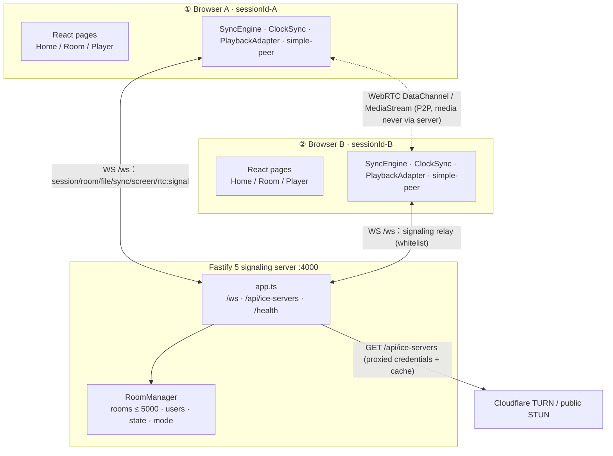
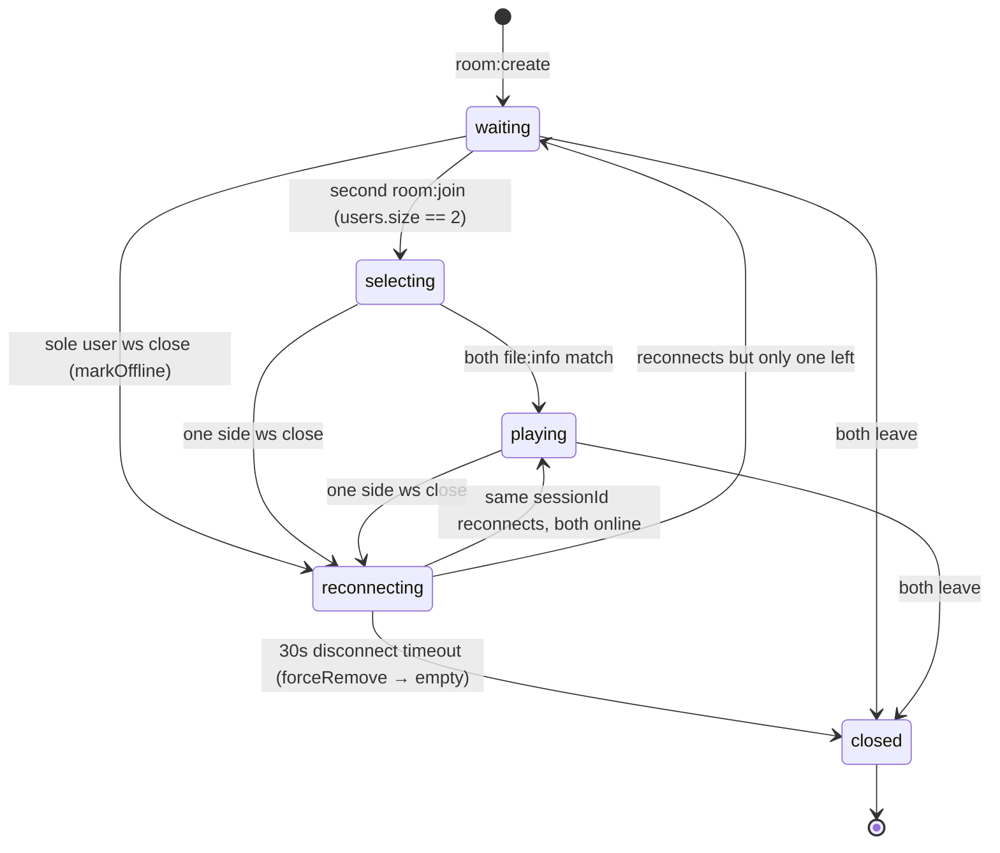
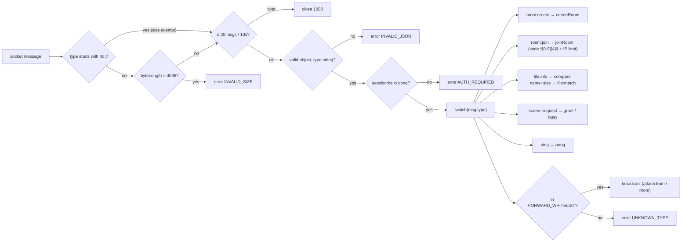
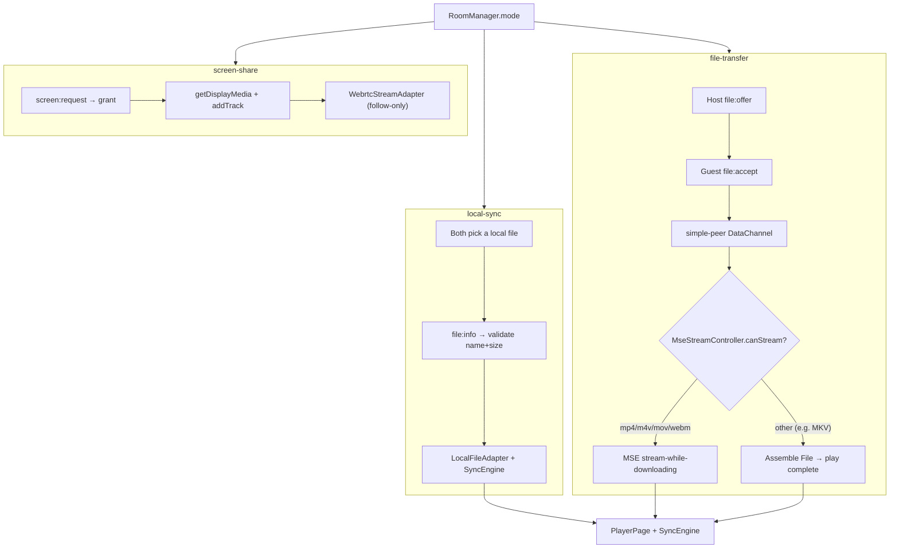

<div align="center">

> **English** | [简体中文](./README.md)


# SameMoon · Watch Together, Apart

**One screen between you, one sofa in spirit — same film, same timeline. Play / pause / seek stay in sync, live.**


</div>

---

## Why it exists

Watching a movie together while apart usually leaves you three options: screen sharing (crushed quality, saturated uplink), browser sync extensions (locked to specific video sites), or "3, 2, 1 — hit play" (manual sync that falls apart the moment anyone pauses).

**SameMoon turns that chore into a 4-digit room code.** Create a room → send the link → take your seats, and the timeline locks together.

- **Nothing gets uploaded**: in local mode both sides hold their own copy; playback uses `URL.createObjectURL(file)` entirely on-device.
- **No sign-up, no install**: no account, no database, just open the page.
- **The server only signals**: it manages rooms and relays signaling; media always travels peer-to-peer.

> Privacy promise: local mode performs zero file uploads; in P2P modes files/media travel over the browsers' WebRTC channels, and the server only relays the signaling that introduces the two peers.

---

## ✨ Features

- 🎬 **Three viewing modes**
  - `local-sync`: both sides hold the same film, validated by "filename + size", then play in sync.
  - `file-transfer`: the host P2P-sends the media to the guest, who needs no local copy.
  - `screen-share`: one side shares their screen live, the other follows along.
- ⏱️ **Sub-second sync engine**: NTP-style clock calibration plus echo suppression, `seq` conflict resolution, three-tier drift correction, and buffering negotiation.
- 🔗 **P2P first**: `simple-peer` DataChannel transfer with Cloudflare TURN fallback for NAT traversal; signaling is a single `rtc:signal`.
- 📥 **Stream while downloading**: MP4 (faststart) / MOV are remuxed on the fly by `mp4box` into fMP4 for `MediaSource`; WebM plays directly; formats MSE can't stream (e.g. MKV) fall back to "complete transfer".
- 🖥️ **Tunable screen share**: four quality presets (smooth / balanced / high / ultra) + frame-rate / audio-bitrate controls + degradation priority (keep audio / keep resolution / keep framerate) + jitter buffer (lowest latency / ≈1s / ≈2s).
- ♻️ **Session recovery**: a stable `sessionId` in `sessionStorage` reconnects and restores the room within 30s after a refresh or drop.
- 🛡️ **Server hardening**: message size/frequency caps, forwarding whitelist, room-code regex, per-IP join rate limit, room-count cap.
- 🧭 **Diagnostics panel**: WS message log, ICE candidate routes, RTC transport stats, and one-click full-snapshot export.

---

## 🚀 Quick Start

### Option 1: For AI agents (one-shot setup, recommended)

Paste this prompt into your local AI agent (Claude Code / Codex / OpenCode …):

````markdown
Please run SameMoon locally (GitHub: https://github.com/RayMorTwinkle/SameMoon).
Context: SameMoon is a watch-together web app; frontend React 19 + Vite, backend Fastify 5 + WebSocket.

Steps:
1. Clone: git clone https://github.com/RayMorTwinkle/SameMoon.git && cd SameMoon
2. Install deps (client + server): npm run install:all
3. Start both: npm run dev
   - frontend http://localhost:3000 (Vite; /ws and /api are proxied to the backend)
   - backend  http://localhost:4000 (Fastify signaling server)
4. Open two browser windows (or one private window), both at http://localhost:3000.
   "Create room" in one, "Join" with the 4-digit code in the other, confirm they connect.
5. Optional: run tests via `cd server && npm test` and `cd client && npm test`.
6. Confirm success to the user and briefly explain the three viewing modes.
````

### Option 2: For humans

```bash
git clone https://github.com/RayMorTwinkle/SameMoon.git
cd SameMoon
npm run install:all     # installs client/ then server/ dependencies
npm run dev             # concurrently starts frontend and backend
```

> **Requirements**: Node.js 18+ (deployed on Node 22), npm. Frontend dev port 3000, backend port 4000.
> `npm run dev` proxies `/ws` (WebSocket) and `/api` to the backend, so no extra config is needed.

---

## 🖥️ Usage

### Typical walkthrough (local-sync mode)

```text
① Open http://localhost:3000
② A picks "local-sync" → clicks "Create room" → gets a 4-digit code + link
③ A sends the link to B → B joins automatically on open
④ Both pick the same film (drag or click; .mp4/.webm/.m4v/.mov/.mkv)
   → the server compares "filename + byte size" and reports a match
⑤ Both click "I'm ready" (this unlocks browser autoplay permission)
⑥ Synced playback: play / pause / seek / rate by either side is followed by the other
```

### Modes at a glance

| Mode | Source | Who acts | Channel |
|------|--------|----------|---------|
| `local-sync` | Each side's local file | Both pick a file | None (sync signaling over WS only) |
| `file-transfer` | Host's local file | Host sends → guest receives | WebRTC DataChannel (P2P) |
| `screen-share` | Sharer's screen | Either side (one at a time) | WebRTC MediaStream (P2P) |

### Environment variables (`server/.env`)

```bash
# Cloudflare TURN (optional; without it only public STUN is used)
TURN_KEY_ID=your_cloudflare_turn_key_id
TURN_API_TOKEN=your_cloudflare_turn_api_token
```

### Build & test

| Command | Purpose |
|---------|---------|
| `npm run dev` | Start frontend (3000) and backend (4000) together |
| `npm run dev:client` / `npm run dev:server` | Start either side alone |
| `cd client && npm run build` | Type-check + production build (outputs `client/dist`) |
| `cd client && npm test` | Frontend vitest (`SyncEngine` pure-logic tests) |
| `cd server && npm test` | Backend vitest (RoomManager / integration / sync forwarding) |

### Production deployment

```bash
# Option A: docker compose (nginx serving static + Node signaling server)
docker compose up -d --build

# Option B: the bundled script (does git push, then SSHes in and rebuilds)
./deploy.sh
# or follow the "build locally + rsync upload" flow in docs/更新服务器SameMoon.sh
```

> In production `nginx.conf` redirects `80` to `443`, serves static files from `client/dist`,
> upgrades `/ws` to WebSocket, and reverse-proxies `/api` to the `sm-server:4000` container.

---

## 🏗️ Architecture

### System overview

Between two browsers: signaling over WebSocket, media over WebRTC P2P; the server handles room management and matchmaking only.



### Sync playback sequence (SyncEngine)

Every `sync:*` message carries the full `PlaybackState` (fully idempotent); programmatic application of remote state is wrapped by `applyingRemote` to suppress echo.

```mermaid
sequenceDiagram
  autonumber
  participant UA as User A (host)
  participant EA as A: SyncEngine
  participant S as Fastify (/ws relay)
  participant EB as B: SyncEngine
  participant UB as User B

  Note over EA,EB: On join: 5 quick samples → median offset of the 3 lowest-RTT

  UA->>EA: click "pause"
  EA->>EA: captureState() (seq+1, sentAt = rawNow)
  EA->>S: sync:pause {paused, time, rate, seq, senderId, sentAt}
  S->>EB: relay sync:pause (whitelist)
  EB->>EB: shouldAccept(): higher seq wins; tie → larger senderId wins
  EB->>EB: applyRemote(): compensate transport delay + echo window
  EB->>UB: video pauses (local event suppressed, not re-broadcast)

  loop every 5s
    EA->>S: sync:heartbeat {clientTime, time, paused, rate}
    S->>EB: relay
    EB->>EA: reply {echoOf=t0, t1, clientTime=t2}
    EA->>EA: ClockSync.addSample(t0,t1,t2,t3) → offset / RTT
    EA->>EA: only the follower (smaller userId) corrects drift
  end

  Note over EA,EB: drift &lt;0.3s ignore ｜ 0.3~2s rate ±5% ｜ &gt;2s seek

  UB-->>EB: local waiting (buffering)
  EB->>S: sync:buffering
  S->>EA: relay → A pauses and waits
  UB-->>EB: canplay
  EB->>S: sync:ready {time}
  S->>EA: relay → align to target time and resume
```

### P2P signaling & transport flow (simple-peer)

Signaling is a single `rtc:signal` (server relays verbatim); `rtc:*` messages are exempt from the 4KB cap. Trickle-ICE candidates buffer in `pendingSignals` and are flushed once the peer exists.

```mermaid
sequenceDiagram
  autonumber
  participant A as Browser A (initiator)
  participant S as Fastify (rtc:signal relay)
  participant T as Cloudflare TURN
  participant B as Browser B (receiver)

  A->>T: GET /api/ice-servers (server-proxied credentials, 24h TTL, refreshed 1h early)
  Note over A,B: simple-peer: new Peer({ initiator: true / false, iceServers })
  A->>S: rtc:signal { offer }
  S->>B: relay rtc:signal
  B->>B: new Peer(initiator:false).signal(offer)
  B->>S: rtc:signal { answer }
  S->>A: relay rtc:signal
  A->>S: rtc:signal { candidate }
  B->>S: rtc:signal { candidate }
  Note over A,B: candidates arriving before the peer exists are buffered, then flushPending()
  A-->>B: WebRTC DataChannel open (file transfer) / MediaStream (screen share)
  Note over A,B: file transfer in 64KB chunks; bufferedAmount &gt;1MB pause / &lt;256KB resume
```

### Room state machine (RoomManager)



> On reconnect the server clears that user's `fileInfo`, moves `playing` back to `selecting`,
> and broadcasts `file:reset`; the client then prompts "room restored, please reselect the file".

### WebSocket message routing & security gates



### Data flow of the three modes



---

## 📂 Project layout

```text
SameMoon/
├── client/                          # React 19 + Vite 8 frontend
│   ├── src/
│   │   ├── App.tsx                  # Routes / · /room/:code · /room/:code/play + global panels
│   │   ├── hooks/useWebSocket.tsx   # Global single WS Context (sessionId / reconnect / ping)
│   │   ├── components/
│   │   │   ├── Room/HomePage.tsx    # Create / join room + mode selector
│   │   │   ├── Room/RoomPage.tsx    # Waiting room: per-mode branch UI
│   │   │   ├── Room/FileTransferPanel.tsx
│   │   │   ├── Player/PlayerPage.tsx # Playback + "I'm ready" + sync controls
│   │   │   └── common/              # DebugPanel / DebugExport / ErrorBoundary / ConnectionStats
│   │   ├── services/
│   │   │   ├── sync/SyncEngine.ts   # Sync engine (decoupled from transport)
│   │   │   ├── sync/ClockSync.ts    # NTP-style clock calibration
│   │   │   ├── playback/            # PlaybackAdapter · LocalFileAdapter · WebrtcStreamAdapter · MseStreamController
│   │   │   ├── webrtc/              # simple-peer: ScreenShare · FileTransferService · PCStatsCollector · stores
│   │   │   └── debugStore.ts        # WS logs / RTC stats / diagnostics export
│   │   └── utils/                   # fileValidator · formatFileSize
│   └── vite.config.ts               # Port 3000 + /ws · /api proxy + node polyfills
├── server/                          # Fastify 5 signaling server
│   ├── src/app.ts                   # /ws + /api/ice-servers + /health + hardening
│   ├── src/room/RoomManager.ts      # Rooms / members / state machine / disconnect timers
│   ├── src/ws/protocol.ts           # WS message type definitions
│   └── test/                        # vitest: RoomManager · integration · sync
├── docs/                            # NEO_PLAN · TECH-SPEC · stage2 PLAN/PLAN2 · deploy scripts
├── docker-compose.yml               # nginx static hosting + Node service
├── nginx.conf                       # HTTPS + /ws upgrade + /api reverse proxy
├── deploy.sh                        # One-shot deploy script
└── wireframe.html                   # Initial UI wireframe
```

---

## 🔧 Technical notes

**Rooms & reconnect**

| Item | Value / Location |
|---|---|
| Room code | `String(Math.floor(1000 + Math.random() * 9000))`, server regex `/^\d{4}$/` |
| Max rooms | `RoomManager.MAX_ROOMS = 5000`, exceeding → `SERVER_FULL` |
| Room states | `waiting` / `selecting` / `playing` / `reconnecting` / `closed` |
| Reconnect window | `disconnectTimeoutMs` defaults to `30_000` (injectable for tests) |
| User identity | `sessionStorage['sm-session']` (`crypto.randomUUID`, hand-rolled UUID fallback off secure contexts) |

**Sync engine (`client/src/services/sync`)**

| Item | Value |
|---|---|
| Clock calibration | sliding window of ≤10 samples; median offset of the 3 lowest-RTT; `isReady` = ≥3 samples |
| Drift thresholds | `driftIgnoreThreshold = 0.3s`; `driftRateThreshold = 2.0s` |
| Rate chasing | behind `playbackRate = 1.05`, ahead `0.95`; no seek within `SEEK_MIN_DELTA = 0.5s` |
| Echo suppression | `applyingRemote` + `echoWindow` default 150ms; post-seek window `SEEK_ECHO_MS = 1500ms` |
| Conflict resolution | higher `seq` wins; on tie the lexicographically larger `senderId` wins |
| leader/follower | smaller `userId` is leader (reference); only the follower corrects drift to avoid tug-of-war |
| Buffering timeout | `BUFFERING_TIMEOUT_MS = 30_000`, then UI offers "watch independently" |

**P2P & file transfer (`client/src/services/webrtc`)**

| Item | Value |
|---|---|
| Chunk size | `CHUNK_SIZE = 64 * 1024` (64KB, safe across browsers) |
| Flow control | `HIGH_WATER = 1MB` (pause) / `LOW_WATER = 256KB` (resume) |
| DataChannel | `channelConfig: { ordered: true }`, label managed by simple-peer |
| Signaling | unified `rtc:signal`; `rtc:*` exempt from 4KB; pre-peer candidates buffered in `pendingSignals` |
| MSE streaming | `MseStreamController.canStream()` matches `\.(mp4|m4v|mov|webm)$` or mime containing mp4/webm; MP4 via `mp4box` remux, `setSegmentOptions(id, sb, { nbSamples: 200 })` |
| Screen-share presets | smooth 2Mbps/720p/30 · balanced 5Mbps/1080p/30 · high 10Mbps/1080p/60 · ultra 20Mbps/2160p/60 |
| Audio | default 128kbps; viewer SDP injects opus `stereo=1;sprop-stereo=1;maxaveragebitrate=256000` |

**Server hardening & ICE (`server/src`)**

| Item | Value |
|---|---|
| Max message size | `MAX_MSG_SIZE = 4096` (4KB) |
| Message rate | `RATE_MAX_MSGS = 30` / `RATE_WINDOW_MS = 10_000` (sliding window), over → `close(1008)` |
| Pre-hello timeout | `HELLO_TIMEOUT_MS = 10_000`, over → `close(1002)` |
| Chat length | `CHAT_MAX_LENGTH = 500`, truncated beyond |
| Join rate limit | `JOIN_MAX_PER_MINUTE = 20` (per IP, anti-enumeration of 4-digit codes) |
| Forward whitelist | `FORWARD_WHITELIST`: `sync:*` / `chat:message` / `rtc:signal` / `file:*` / `screen:*` / `player:ready`; others → `UNKNOWN_TYPE` |
| ICE credentials | `GET /api/ice-servers` cache TTL = `86_400 - 3_600`s; fallback `stun.cloudflare.com:3478` + `stun.l.google.com:19302` |

**Ports & routes**

| Item | Value |
|---|---|
| Frontend dev / preview | `3000` (Vite; `/ws` and `/api` proxied to 4000) |
| Backend | `4000` (`PORT` override) |
| HTTP endpoints | `/health` (`{ status, rooms }`), `/api/ice-servers` |
| WebSocket | `/ws` (upgraded by nginx in production) |
| Frontend routes | `/`, `/room/:code`, `/room/:code/play` |

---

## ❓ FAQ

**Q: Will my movie file be uploaded to the server?**
A: No. In `local-sync` mode the file plays only on your machine via `URL.createObjectURL`; `file-transfer` uses a WebRTC DataChannel between browsers. The server relays signaling only and never touches media.

**Q: Is TURN mandatory?**
A: No. Without it only public STUN is used, which still connects on LANs or typical NATs; TURN is the fallback for hole-punching failures such as symmetric NAT (set `TURN_KEY_ID` / `TURN_API_TOKEN` in `server/.env`).

**Q: How many people per room?**
A: Two (`room.users.size >= 2` rejects joins), designed for one-on-one co-viewing.

**Q: Why can't some MKV files stream?**
A: `MediaSource` doesn't support the MKV container, so `MseStreamController.canStream()` returns false and the UI automatically switches to "complete transfer" — download fully, then watch together.

**Q: Can a phone start a screen share?**
A: No. Mobile browsers (Android Chrome/Edge, iOS Safari) haven't shipped `getDisplayMedia`; phones can view only. Start the share from a desktop.

**Q: Why must I reselect the file after a refresh?**
A: `objectURL` is invalidated by a refresh. The server restores the room and the last filename/size via `session:restored`, but you must re-pick the same file (name+size check) to resume.

**Q: Are online video links or YouTube supported?**
A: Not yet. `PlaybackAdapter` already reserves `direct-url` / `youtube` source kinds for a planned later stage.

---

## ⚠️ Notes

- **Secure context**: `getDisplayMedia` / `getUserMedia` / clipboard APIs require HTTPS (except `localhost`); production must use HTTPS/WSS.
- **4-digit codes are enumerable**: mitigated by "20 joins per IP per minute" rate limiting, but not a strong security boundary.
- **Licensing**: the repo ships no LICENSE file, so all rights are reserved by default; also the UI library `animal-island-ui` is **CC BY-NC 4.0 (non-commercial)** and must be replaced before commercial use.
- **Missing Dockerfile note**: the root `docker-compose.yml` references `server/Dockerfile`, but that build file is not included in this repo (deployment artifacts live in the server directory). For local development just use `npm run dev`.
- **Deploy script performs writes**: `deploy.sh` runs `git push` and SSHes in to rebuild containers; do not run it unless you mean to.
- **Degradation without P2P**: the design goal is to keep WS usable when P2P fails; in the current implementation file-transfer/screen-share depend on P2P and will prompt a retry if the connection can't be established.

---

## 📄 License

This repository currently **ships no open-source license file**; all rights are reserved by default.

Add a license (e.g. MIT) before distributing or permitting reuse.
Note that the dependency `animal-island-ui` is **CC BY-NC 4.0 (non-commercial)**, which must be assessed/replaced before commercial use.

---

## 🙏 Credits

- Repository: [RayMorTwinkle/SameMoon](https://github.com/RayMorTwinkle/SameMoon)
- UI library [animal-island-ui](https://www.npmjs.com/package/animal-island-ui) (Animal Crossing style, non-commercial license) + [lucide-react](https://lucide.dev/) icons
- Player [ArtPlayer](https://artplayer.org/); container parsing [mp4box.js](https://github.com/gpac/mp4box.js)
- P2P wrapper [simple-peer](https://github.com/feross/simple-peer)
- Backend [Fastify](https://fastify.dev/) + [@fastify/websocket](https://github.com/fastify/fastify-websocket) + [@fastify/cors](https://github.com/fastify/fastify-cors)
- NAT traversal credential service [Cloudflare Realtime TURN](https://developers.cloudflare.com/realtime/turn/)
- This bilingual README and its diagrams were produced for this project.

---

<div align="center">
<sub>SameMoon · It's the same moon — let's watch it together.</sub>
</div>
